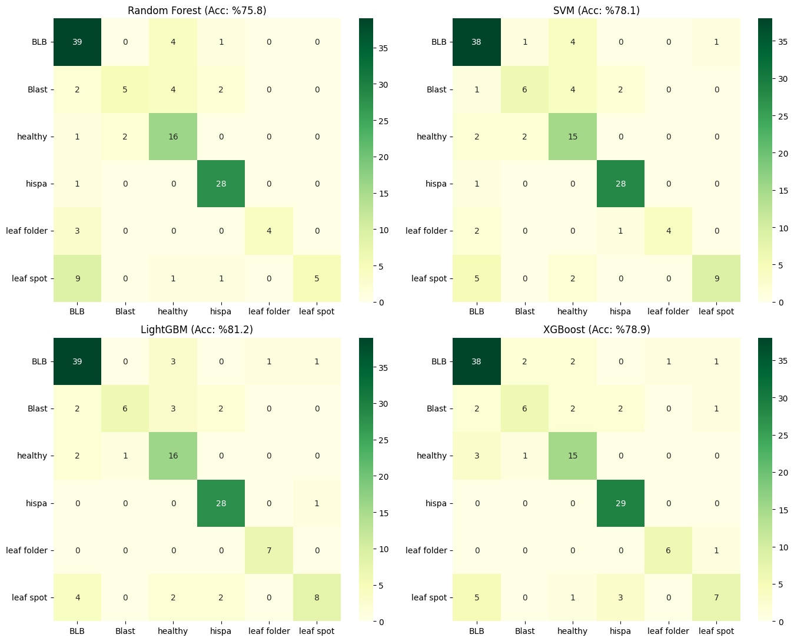
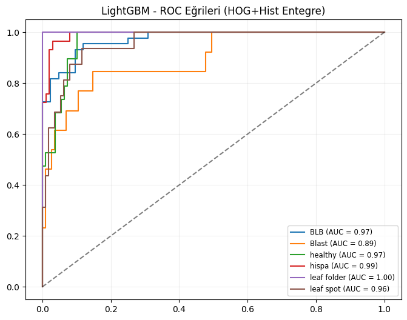

# Thermal Plant Disease Detection

Classifying rice (paddy) leaf diseases from **thermal images** with hand-crafted image features and classical machine-learning models.

The best model, **LightGBM on combined HOG + HSV histogram + LBP features, reaches 81.2% accuracy** (weighted F1 0.80) across 6 classes.

## Problem

Plant diseases change leaf temperature and texture before they are clearly visible to the eye. Thermal cameras capture that signal, but the images are low-contrast and the dataset is small (~635 images). Deep CNNs overfit easily at this size, so this project asks: **how far can carefully chosen hand-crafted features take a classical classifier?**

## Dataset

[Thermal Images – Diseased & Healthy Leaves (Paddy)](https://www.kaggle.com/datasets/sujaradha/thermal-images-diseased-healthy-leaves-paddy) on Kaggle — 6 classes:

| Class | Type |
|---|---|
| BLB (Bacterial Leaf Blight) | bacterial disease |
| Blast | fungal disease |
| Leaf spot | fungal disease |
| Hispa | insect damage |
| Leaf folder | insect damage |
| Healthy | — |

The dataset is not included in this repository. The notebook downloads it with the Kaggle API.

## Method

1. Resize every image to 128 × 128.
2. Extract three complementary feature groups and concatenate them:
   - **HOG** (9 orientations, 16×16 cells): leaf shape and edge structure
   - **HSV colour histogram** (32 bins per channel): temperature distribution in the thermal palette
   - **LBP** (uniform, P=8, R=1): fine surface texture
3. Standardise features and use a stratified 80/20 train/test split.
4. Train and compare **Random Forest, SVM (RBF), LightGBM and XGBoost**.
5. Evaluate with confusion matrices, one-vs-rest ROC curves and per-class precision/recall/F1.

## Results

### Final model comparison (HOG + HSV + LBP)

| Model | Accuracy | Weighted Precision | Weighted Recall | Weighted F1 |
|---|---|---|---|---|
| **LightGBM** | **0.812** | **0.817** | **0.812** | **0.802** |
| XGBoost | 0.789 | 0.779 | 0.789 | 0.776 |
| SVM | 0.781 | 0.795 | 0.781 | 0.775 |
| Random Forest | 0.758 | 0.789 | 0.758 | 0.737 |

### Feature engineering progression

The final feature set was reached step by step. Each row shows the best model for that feature set:

| Features | Best model | Accuracy |
|---|---|---|
| HOG only | LightGBM | 0.758 |
| HOG + RGB histogram | LightGBM | 0.789 |
| **HOG + HSV histogram + LBP** | **LightGBM** | **0.812** |
| HOG + HSV + LBP + data augmentation (rotation, shift, flip) | LightGBM | 0.806 |

Takeaways:
- Adding **colour/temperature information** to shape features gave the largest gain. In thermal images, colour encodes temperature, which is the disease signal.
- Moving from RGB to **HSV** and adding **LBP texture** improved accuracy further and helped the minority classes most. For SVM, accuracy went from 0.54 (HOG only) to 0.78.
- **Data augmentation did not help.** Geometric transforms don't add new thermal information, so the final model is trained without it.
- **Blast** is the hardest class (AUC 0.89). Fewer than half of its test images are recognised; the rest are spread across healthy, BLB and hispa.

## Run it

Open [`notebooks/thermal_disease_hog_hsv_lbp.ipynb`](notebooks/thermal_disease_hog_hsv_lbp.ipynb) in Google Colab and run all cells. When prompted, upload your `kaggle.json` API token (Kaggle → Settings → *Create New Token*).

To run locally instead, run `pip install -r requirements.txt`, then download the dataset and update `data_path` in the notebook.

## Tech stack

Python · OpenCV · scikit-image · scikit-learn · LightGBM · XGBoost · pandas · matplotlib / seaborn

## Limitations

- The dataset is small and imbalanced. Some classes have fewer than 10 test images, so per-class scores are noisy.
- Results come from a single train/test split. Cross-validation would give more stable estimates.

---

Developed as a course project at Ankara University, Computer Engineering (Spring 2026).
Author: **Simge Karsavuranoğlu**
